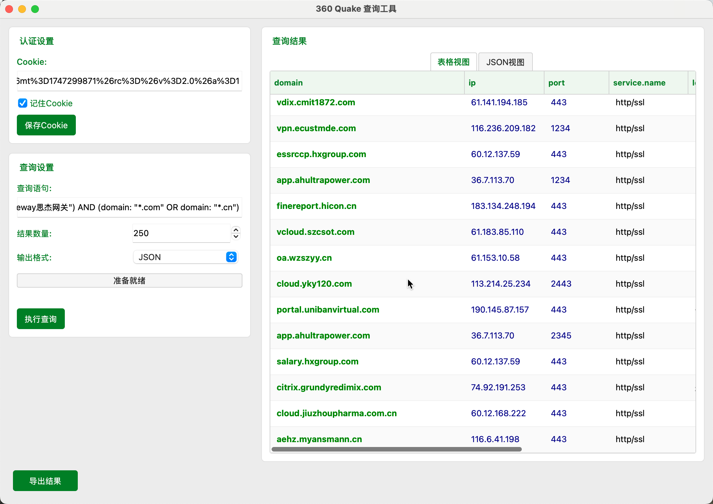

# 360Quake 查询工具

一个基于 PyQt6 开发的 360 Quake 网络空间测绘引擎查询工具，提供了简单直观的图形界面，支持多种数据导出格式。

[](https://github.com/RiderTimeDecade/360quake/blob/main/LICENSE)
[](https://www.python.org/downloads/)
[](https://pypi.org/project/PyQt6/)

## 功能特点

- 现代化的图形用户界面
- 支持大规模数据查询（最多100,000条结果）
- 实时查询进度显示
- 多种导出格式（JSON、CSV、URL）
- 支持 Cookie 认证管理
- 跨平台支持（Windows、macOS、Linux）
- 异步查询，避免界面卡顿
- 支持查询结果表格排序和过滤

## 安装说明

### 使用预编译版本

直接从 [Releases](https://github.com/RiderTimeDecade/360quake/releases) 页面下载对应平台的可执行文件：

- Windows: `360Quake查询工具_windows.exe`
- macOS: `360Quake查询工具_darwin.app`
- Linux: `360Quake查询工具_linux`

### 从源码构建

1. 克隆仓库并进入目录：
```bash
git clone https://github.com/RiderTimeDecade/360quake.git
cd 360quake
```

2. 安装依赖：
```bash
pip install -r requirements.txt
```

3. 运行程序：
```bash
python main.py
```

4. 构建可执行文件：
```bash
python build.py
```

## 使用说明

### 程序界面



1. 启动程序后，在认证设置区域输入您的 360 Quake Cookie
2. 在查询设置区域输入查询语句（支持标准的 Quake 查询语法）
3. 设置需要获取的结果数量（1-100000）
4. 选择导出格式（JSON、CSV 或 URL 格式）
5. 点击"执行查询"按钮开始查询
6. 查询完成后可以查看结果或导出数据

### 查询语法说明

工具支持完整的 360 Quake 查询语法。输入规则：

- 输入完整查询语句（含 `字段: "值"` 或 `字段="值"` 字段符，或 `AND`/`OR`/`NOT` 逻辑运算）时，语句将**原样透传**至服务端
- 仅输入裸关键词（如 `example.com`）时，默认按 `domain` 字段查询
- 建议为字段值加英文双引号，尤其是值中包含空格、冒号或中文时

### 查询语法示例

**基础字段查询**

| 场景 | 示例 |
|------|------|
| 域名 | `domain: "example.com"` |
| IP / CIDR | `ip: "1.1.1.1"` / `ip: "1.1.1.0/24"` |
| 端口 | `port: "443"` |
| 服务 | `service: "http"` |
| 应用组件 | `app: "Apache"` |
| 主机名 | `hostname: "example.com"` |
| 备案号 | `icp="京ICP证030173号"` |
| 证书 | `cert: "example.com"` |
| 网页标题 | `title: "后台登录"` |
| 响应体 | `body: "keywords"` |

**地理位置与组织**

| 场景 | 示例 |
|------|------|
| 国家 | `country: "CN"` |
| 省份 | `province: "Beijing"` |
| 城市 | `city: "Shanghai"` |
| 组织 | `org: "Alibaba"` |

**组合与逻辑查询**

```text
service: "http" AND country: "CN"
port: "8080" AND service: "tomcat"
domain: "example.com" AND NOT port: "443"
(ip: "1.1.1.1" OR domain: "example.com") AND service: "http"
```

**裸关键词**

```text
example.com        # 自动按 domain: "example.com" 查询
```

### 导出格式说明

1. JSON 格式：完整的查询结果，包含所有字段
2. CSV 格式：表格形式，包含常用字段，方便在 Excel 中处理
3. URL 格式：`protocol://ip:port` 格式，方便直接访问服务

## 项目结构

```
360quake/
├── main.py              # 程序入口
├── build.py            # 构建脚本
├── requirements.txt    # 依赖列表
├── src/
│   ├── config/        # 配置文件
│   ├── core/          # 核心功能
│   ├── ui/            # 用户界面
│   └── utils/         # 工具函数
└── assets/            # 资源文件
```

## 技术栈

- Python 3.8+
- PyQt6 6.6.1
- requests 2.31.0
- PyInstaller 6.3.0

## 常见问题

1. **为什么需要输入 Cookie？**
   - Cookie 用于 360 Quake 的身份认证，可以从浏览器登录 360 Quake 后获取

2. **如何获取 Cookie？**
   - 登录 [360 Quake](https://quake.360.net/)
   - 打开浏览器开发者工具（F12）
   - 在 Network 标签页中找到任意请求
   - 在请求头中复制 Cookie 字段的值

3. **查询结果数量限制是多少？**
   - 单次查询最多支持 100,000 条结果
   - 实际可查询数量取决于您的 360 Quake 账户权限

4. **程序支持哪些平台？**
   - Windows 7 及以上版本
   - macOS 10.14 及以上版本
   - 主流 Linux 发行版

## 更新日志

### 2026-10-14

- **修复查询语句被错误添加 `domain:` 前缀（issue #7）**：此前输入 `icp="xxx"` 等不含冒号的字段查询会被整体包裹成 `domain: "icp="xxx""`，导致查询结果与预期不符。现仅对裸关键词（无字段符、无逻辑运算符）补全 `domain:` 前缀，含 `field: value` 或 `field="value"` 字段符及 `AND/OR/NOT` 的查询语句原样透传（[main_window.py](src/ui/main_window.py) `_format_query`）
- **修复查询清理阶段误剥引号**：`_clean_query` 此前会剥掉查询末尾的引号（如 `icp="xxx"` 变成 `icp="xxx`），现仅当整句被双引号完整包裹时才移除外层引号；同时 `domain:` 开头的复合查询不再被整句裹入引号（[query_manager.py](src/core/query_manager.py) `_clean_query`）
- 验证：本地 9 条语句处理用例全部通过；真实接口验证裸关键词（`baidu.com`）与 `icp="京ICP证030173号"` 均正确命中目标数据

## 贡献

欢迎提交 Issue 和 Pull Request！

## 许可证

本项目采用 [MIT 许可证](LICENSE) 